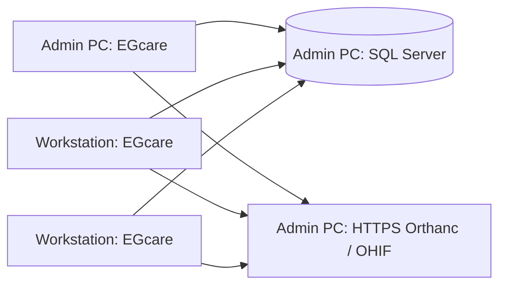

# EGcare installation on the clinic LAN

Install the same EGcare desktop application on the admin PC and every workstation. Each copy runs its own business logic and connects to one shared SQL database on the admin PC. The admin PC also hosts the central Orthanc archive when images are used. There is no separately installed EGcare API application and no localhost business listener.



## Prepare the admin PC

1. Give the admin PC a stable LAN address and network name. Use that same name in every connection file, including the admin PC's file. Do not use localhost, a workstation's SQL instance or a different database for each computer.
2. Install and maintain a supported SQL Server instance. SQL Server Express has capacity limits; check those against the clinic's expected database size before choosing an edition. Insurance documents are stored in the shared database; DICOM image files are stored in Orthanc.
3. Enable SQL TCP/IP and choose a fixed port. Configure a SQL Server TLS certificate matching the connection hostname. Install the issuing CA certificate in every workstation's trusted certificate store. The app uses `Encrypt=True;TrustServerCertificate=False`; do not disable certificate validation to work around a certificate error. Limit inbound SQL traffic to the clinic subnet and avoid internet port forwarding. See [Microsoft's SQL certificate configuration](https://learn.microsoft.com/en-us/sql/database-engine/configure-windows/configure-sql-server-encryption).
4. The person running initial setup/upgrades needs a Windows SQL administrator account. EGcare maintenance enables contained database authentication and uses contained users within the clinic database. Everyday clinic accounts are individually provisioned with restricted database permissions; they are never assigned `db_owner` or server administration. See [Microsoft's contained-user guidance](https://learn.microsoft.com/en-us/sql/relational-databases/security/contained-database-users-making-your-database-portable).
5. Prepare a backup directory on the SQL Server PC. The SQL Server service identity needs permission to write there. Set up scheduled SQL backups, encrypted/offline copies and disk monitoring. The pre-upgrade backup is an additional copy, not the clinic's routine backup schedule.

## Install and connect EGcare

Keep an offline kit containing the EGcare Velopack installer, a WebView2 offline installer, SQL Server setup and the selected Orthanc Windows distribution/plugins. The EGcare package contains the required .NET and Windows App SDK runtime files. Install WebView2 where absent. Routine use and updates from the clinic share do not require internet access.

On the admin PC, start EGcare and choose **Admin PC setup / upgrade**. Enter the SQL network name and database. Use **Create a new, empty clinic database** only for a new clinic; it refuses an existing database. Supply a strong initial administrator password. Existing databases require a new backup filename and the current administrator credentials when establishing the first connection. Existing administrators are not silently reset or unlocked. If legacy insurance documents exist, select their original folder; maintenance copies their content into SQL and leaves the originals intact.

Choose **Exit** from EGcare's system tray menu on every workstation before an upgrade. The window's close button keeps EGcare running in the tray and does not release its database connection. Maintenance takes an exclusive database lease and refuses to proceed while a connected production client holds a shared lease. A lost SQL session requires the client to sign in again. A workstation with an incompatible schema/security contract is stopped with an upgrade message.

After setup, sign in with the clinic administrator username/password and change an initial password when prompted. Create the staff accounts and roles inside EGcare. Account creation/reset provisions the matching SQL contained user in the same transaction. Account/role mutations are administrators-only in this architecture; read-only user/role directories remain available to authorized staff. Imported legacy staff need an explicit administrator password reset before their first SQL sign-in, because existing password hashes cannot be converted back into plaintext SQL credentials.

Export the public connection file from clinic settings and import it on every workstation. It contains no credentials. Alternatively, generate it without changing SQL or installing services:

```powershell
./scripts/New-ClinicConfiguration.ps1 -Server 'ADMIN-PC.clinic.test,1433' -Database EGcareClinic -PacsUrl 'https://ADMIN-PC.clinic.test:8042' -UpdatesDirectory '\\ADMIN-PC\EGcareUpdates' -OutputPath EGcare-clinic.json
```

Each Windows user's local profile defaults to `%LOCALAPPDATA%\EGcare\clinic.json`. `EGCARE_CLIENT_CONFIG_PATH` can select another profile path. The public file never contains credentials. To restore sign-in after an app restart, EGcare saves the individual SQL credential, tokens, clinic identity and expiry together using Windows DPAPI protection for the current Windows user. There is no plaintext fallback. Image-server passwords remain in memory.

Closing to the tray keeps the current sign-in. Fully exiting releases the database connection; reopening reconnects and revalidates the account before displaying authenticated pages. Restoring a direct SQL session preserves its original 12-hour expiry. Logout clears the saved session, and expired sessions, changed credentials or a different clinic connection require a fresh sign-in. A LAN failure during startup preserves the saved session and offers connection retry. Initial-password sessions are not persisted until the required password change is complete.

The embedded browser stores its user data under `%LOCALAPPDATA%\EGcare\WebView2`, outside the installed app. Treat browser caches and local diagnostics as clinic data: protect Windows user profiles and use workstation disk encryption. Browser user data must never be copied into a release feed.

## Windows startup and system tray

The installed app opens automatically when the current Windows user signs in. Its startup entry uses Velopack's `Update.exe start` launcher, so application updates do not leave a path to an old version. Startup is enabled on installation or the first launch after upgrading from an older release. Visual Studio builds and portable copies do not register themselves as startup applications. Uninstalling removes EGcare's startup entry.

Closing the window, including **Alt+F4**, hides it in the notification area and preserves the current screen. Click the EGcare tray icon or choose **Open EGcare** to restore it. Opening the installed app again restores the running instance. Right-click the icon and choose **Exit** to disconnect and fully quit. The tray menu also includes **Start with Windows** for enabling or disabling automatic startup; that choice is retained across updates. Windows sign-out and shutdown are allowed to proceed normally.

## Central images

Install Orthanc once on the admin PC with the DICOMweb and OHIF plugins. Run its Windows service under a dedicated identity with access only to the required configuration and archive storage. Configure the service using its installer documentation; EGcare never starts a separate archive process on a workstation.

- Enable `AuthenticationEnabled`, `RemoteAccessAllowed`, `SslEnabled` and a certificate/private-key PEM file via `SslCertificate`. Protect that file and `RegisteredUsers` with Windows ACLs. Trust the certificate's CA on every client. The configured EGcare `PacsUrl` is the HTTPS origin, without a path or credentials.
- Set DICOMweb `Root` and `PublicRoot` to `/dicom-web/`, enable DICOMweb, and set OHIF `DataSource` to `dicom-web` with its normal `/ohif/` router basename. Verify the installed plugin versions together. [Orthanc DICOMweb](https://orthanc.uclouvain.be/book/plugins/dicomweb.html) and [OHIF](https://orthanc.uclouvain.be/book/plugins/ohif.html) document these settings.
- Copy `scripts/OrthancReadOnly.lua` into the protected configuration directory and include its absolute path in `LuaScripts`. The policy permits authenticated viewing accounts to GET the DICOMweb/OHIF routes, denies their writes, and reserves archive administration for `archive-admin` from loopback. Set `ExecuteLuaEnabled`, `RestApiWriteToFileSystemEnabled` and `WebDavEnabled` to false. Give each image viewer a separate `RegisteredUsers` account; keep the archive administrator password off workstations. [Orthanc's security guide](https://orthanc.uclouvain.be/book/faq/security.html) explains the request filter and LAN security settings.
- Configure known modalities with their AET, IP address and port. Set `DicomAlwaysAllowStore=False`, `DicomAlwaysAllowEcho=False`, `DicomCheckModalityHost=True` and `DicomCheckCalledAet=True`. Restrict the DICOM port to the scanners and HTTPS to the clinic PCs. Use DICOM TLS where the equipment supports it.
- Enter the person's image credentials in EGcare's **Image server account** dialog. Credentials are verified and then kept in memory. The image viewer uses the configured origin; image linking additionally verifies the exact patient code, accession and study UID. SQL and archive accounts are separate; account disablement must include the matching archive account.

Back up both the Orthanc index and image storage using a consistent archive backup procedure, along with protected configuration. Test restoration to a separate staging environment. SQL alone is not a complete image backup.

## Updates and builds

The release workflow verifies tests and creates one Velopack Windows application installer. It no longer publishes a separate EGcare server ZIP. Configure the CI signing provider/credentials and repository secret `EGCARE_SIGN_TEMPLATE` (Velopack's custom signing command with its `{{file}}` placeholder). The workflow refuses to publish without signing and checks both the installer and packaged application signatures before creating a release. Unsigned local candidates are for staging.

Copy the complete Velopack release feed (packages and release metadata) into the configured LAN update folder. Only trusted administrators should be able to write to that folder; workstations need read access. Sign release executables/installers with the clinic's chosen release-signing process before distributing them.

The sign-in screen checks the LAN feed and shows when an update is available. Open **Clinic updates** there or in the signed-in profile menu to check, download, and then choose **Install and restart** after saving your work. This entry point remains available before SQL sign-in, so an older client can update when the database rejects its version. Development builds cannot install updates. The updater starts before native UI initialization, following [Velopack's startup guidance](https://docs.velopack.io/integrating/overview).

For an update that changes database migrations or security, choose **Exit** from the tray on all clients, update the admin PC, run backed-up maintenance there, and then update the other workstations. Normal clients do not modify the schema. A newer database rejects an old client; this prevents silent mixed-version writes. See [Velopack file update sources](https://docs.velopack.io/integrating/update-sources).

```powershell
dotnet publish src/Desktop/RadiologyCenter.Desktop/RadiologyCenter.Desktop.csproj -c Release -f net10.0-windows10.0.19041.0 -r win-x64 --self-contained true -p:WindowsPackageType=None -p:WindowsAppSDKSelfContained=true -o publish/app
vpk pack -u RadiologyCenter -v 1.0.0 -p publish/app --mainExe RadiologyCenter.Desktop.exe -o release
```

## Visual Studio development

Keep your database connection in the ignored `src/Desktop/RadiologyCenter.Desktop/appsettings.Development.json`. Debug builds copy it to their output; Release publication excludes it. Debug uses that development SQL connection and legacy application sign-in inside the same process, with no localhost API process. A development public clinic profile takes precedence over the private development file. Use a separate development/staging database rather than clinical data.

Existing development databases need explicit backup-first maintenance to apply missing migrations. Startup shows the maintenance message until that has been done; it does not automatically migrate or reset the administrator. Only explicitly authorized administrators should perform recovery of a previously affected database.

## Acceptance before clinical use

Use synthetic data on a staging server and two separately installed Windows workstations with internet disconnected:

1. Verify fresh installation, first connection, certificate trust, individual sign-in, required password change, role permissions and immediate account revocation. Test the native splash and first-run screen on the actual Windows display/DPI.
2. Book simultaneous appointments from both PCs. Verify Cairo dates, resource conflicts, leave/shift restrictions, drag/reschedule, unassigned bookings and Arabic/English forms.
3. Open cash sessions, collect/refund examination payments, complete an examination and verify shared readback. Save conflicting report edits, finalize/amend a report, and confirm that historical versions are preserved. Exercise worklist paging/search with representative clinic volume.
4. Send a synthetic study from the real scanner. Verify exact patient/accession mapping, QIDO metadata, actual OHIF series/frames, TLS and read-only archive permissions. Attempt image writes with a viewing account and verify rejection.
5. Upload/download insurance documents from different PCs. Exercise settlement, payroll date boundaries and stock receipt/issue. Unconfigured SMS/email/push must report unavailable delivery.
6. Disconnect/reconnect the LAN, restart the server, test backup overwrite protection and maintenance with an open client, and install an update from the local feed. Restore SQL and PACS backups into a separate environment and compare records, documents and images.

The app depends on the admin PC being available. It does not create per-workstation patient databases or support offline writes. Direct SQL assumes managed, trusted workstations: authorized table access can bypass some app workflow checks outside EGcare, even though SQL permissions and account controls are enforced. Keep SQL access restricted to the clinic LAN and grant staff only the permissions they need.
